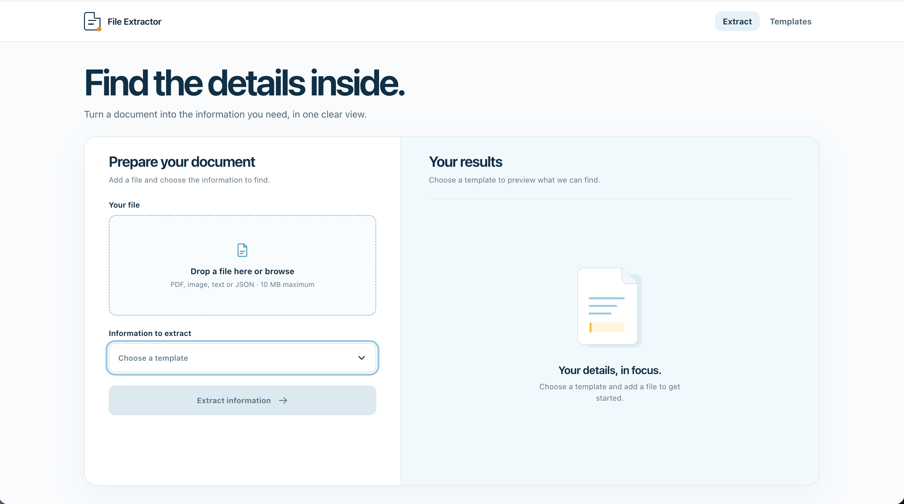
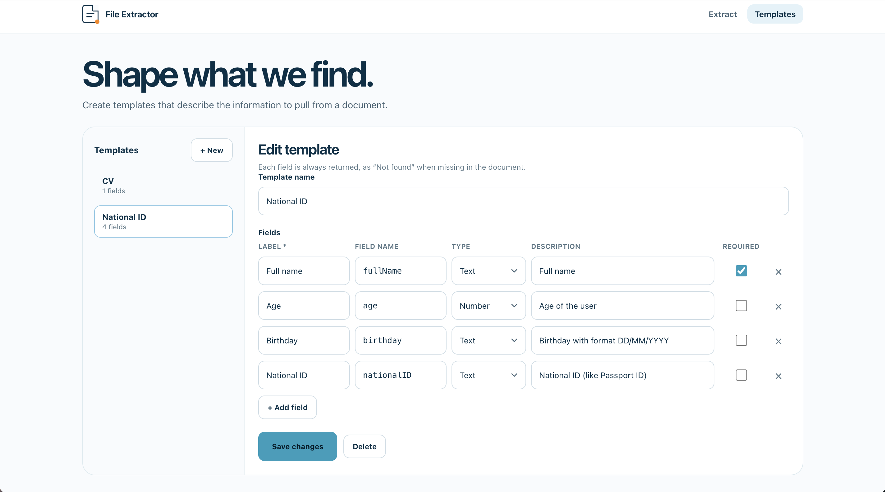
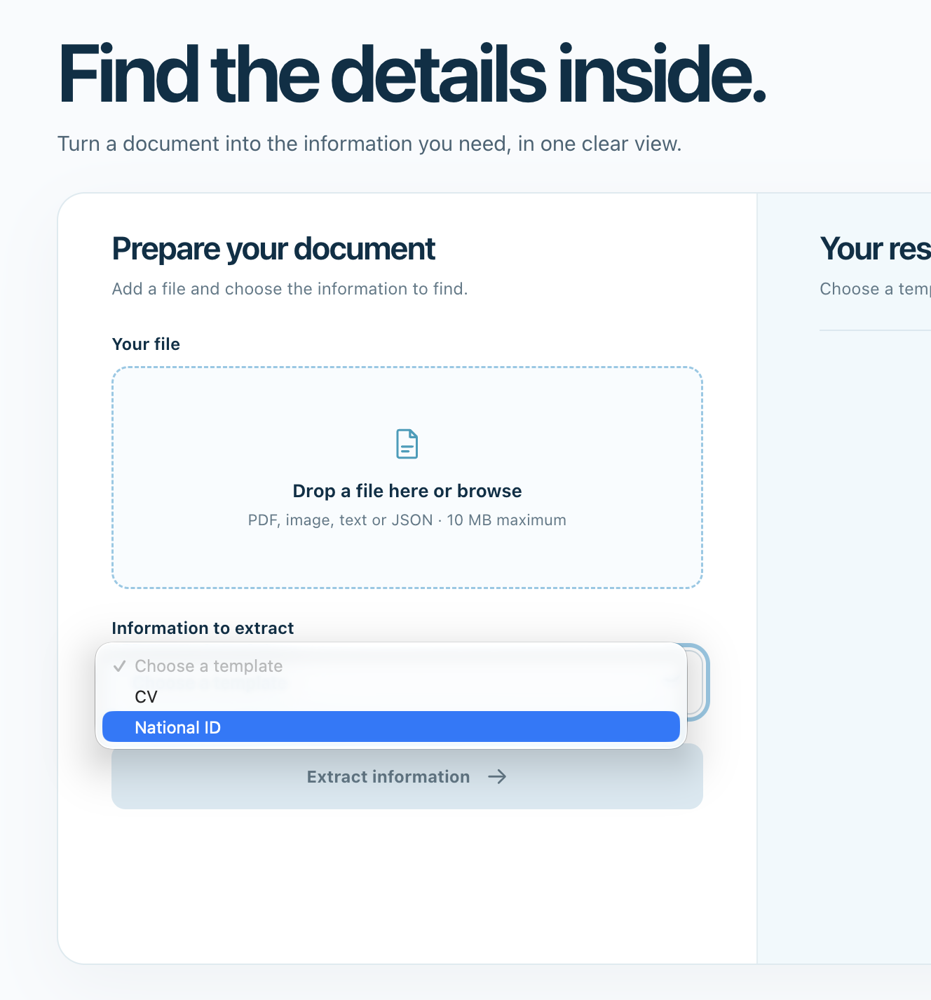
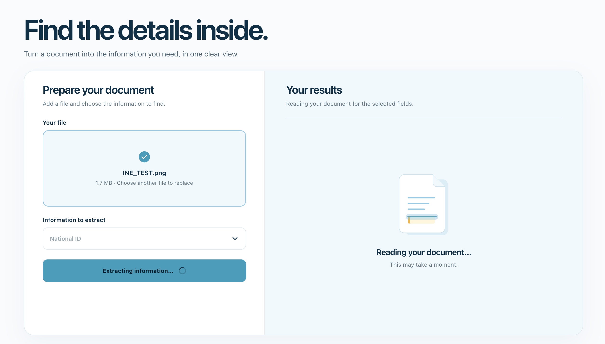
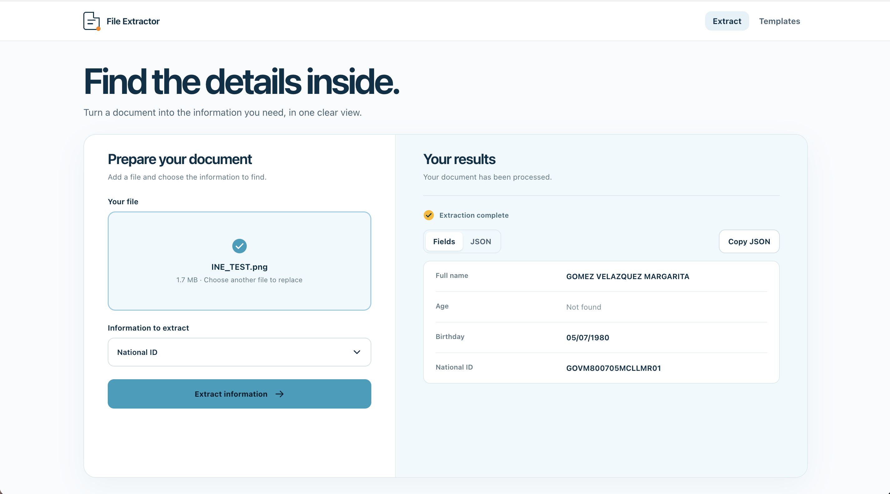
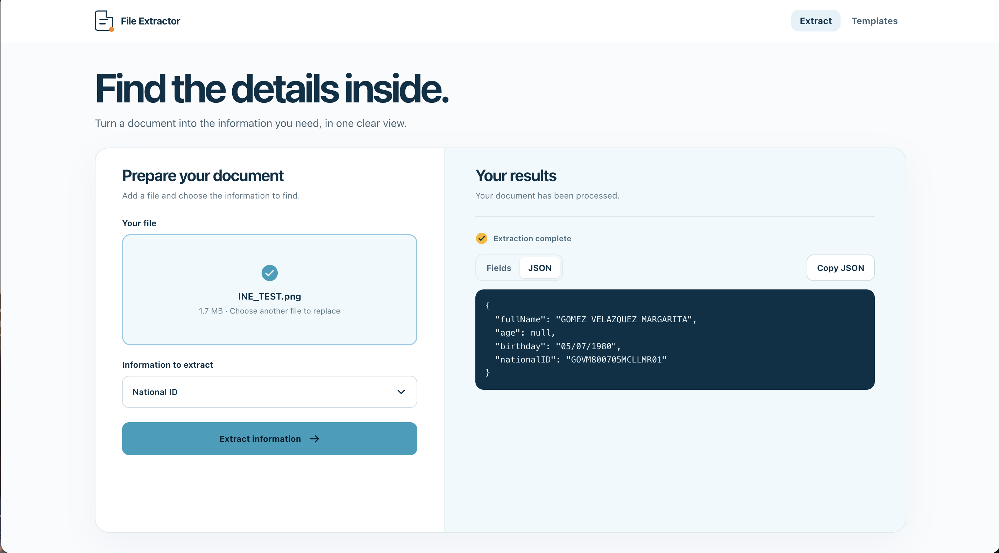

# File Extractor

A small React UI for uploading a file, selecting an extraction template, and viewing the backend's extracted fields.

## Screenshots


### Home



### Templates



### Select template



### Processing file: Getting structured output



### Result



### Result as JSON




## Architecture flow



## Run locally

1. In `backend`, create a `.env` file with `OPEN_AI=<your OpenAI API key>` and `MODEL=<model name>`. `OPENAI_API_KEY` also works in place of `OPEN_AI`.
2. Start the API: `cd backend && pnpm install && pnpm dev` (port 8000).
3. Start the UI in another terminal: `cd frontend && pnpm install && pnpm dev` (port 5173).

Vite proxies `/templates` (API requests only; browser navigation to the `/templates` page is served by the app) and `/file` to the backend during local development. The backend accepts PDF, image, text, and JSON files up to 10 MB.

## Run with Docker

1. Copy `backend/.env.example` to `backend/.env` and set `OPENAI_API_KEY` (or `OPEN_AI`) and `MODEL`.
2. From the repository root
```sh
docker compose up --build -d
```
3. Open http://localhost:5173. The API is also available at http://localhost:8000.

The frontend container runs `pnpm run start` to serve its built files with Vite preview. It uses `http://localhost:8000` as its API URL by default. To use another browser-accessible address, set `BACKEND_URL` when building, for example `BACKEND_URL=https://api.example.com docker compose up --build -d`. Rebuild the frontend after changing this value. For a different frontend origin, set `FRONTEND_ORIGIN` in `backend/.env` to that origin.

Run `docker compose down` to stop both services. The Compose file limits the backend to 768 MB of RAM and 1 CPU, and the frontend to 256 MB of RAM and half a CPU. Adjust `mem_limit` and `cpus` in `compose.yaml` for your machine.

For a frontend hosted separately from the API, set `VITE_API_URL` when building the frontend and set `FRONTEND_ORIGIN` on the backend to the frontend origin. Multiple origins can be comma separated.

## Database

Templates are stored in MongoDB (collection `templates`). Start it with `docker compose up -d mongo`; for local development the backend defaults to `MONGODB_URI=mongodb://localhost:27017/extractor` (see `backend/.env.example`). With `docker compose up`, the backend connects to the `mongo` service and data persists in the local `./mongo_db` folder (git-ignored). Delete that folder to reset all templates.
